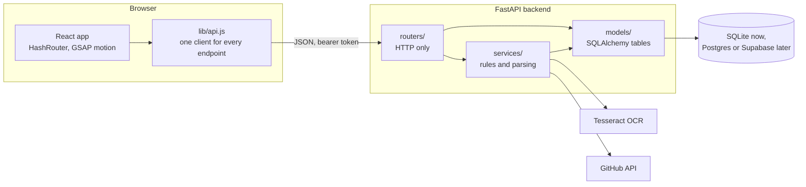

# SkillDNA AI: architecture and design system

This document describes how the project is put together, why, and the rules to follow when changing it.

## 1. System overview

- **Frontend** (`frontend/`): React 19 with Vite. Routes use `HashRouter`, so the app works on static hosting (GitHub Pages) without server rewrites.
- **Backend** (`backend/`): FastAPI. Routers handle HTTP and validation; services hold the rules (identity, scoring, plan, daily challenge); models hold the tables.
- **Dev wiring:** Vite proxies every backend route prefix to port 8000 (see `vite.config.js`). Production sets `VITE_API_URL`.

## 2. Frontend layers

| Layer | Folder | Responsibility | May import from |
|---|---|---|---|
| Pages | `src/pages/` | One screen each. Composes layout and components, owns page state. | components, ui, layout, lib, context |
| Layout | `src/layout/` | Shared chrome: the app header and its navigation list. | ui, context, lib |
| Components | `src/components/` | Feature components: upload cards, report panel, history, motion helpers. | ui, lib |
| UI primitives | `src/ui/` | Design-system pieces with no business logic: Button, Card, Badge, EmptyState, Skeleton, ThemeToggle, Toast, ErrorBoundary. | lib only |
| Lib | `src/lib/` | Non-React logic: API client, theme store, motion utilities, account rules. | nothing from React components |
| Context | `src/context/` | Auth session. | lib |

Rules:
1. Pages never call `fetch`. They call `api.*` from `lib/api.js`, so the base URL, token and error shape live in one place.
2. Shared primitives are used instead of hand-written styles. A new button is a `Button`, a new card is a `Card`.
3. Components that need a router, auth or toasts read them through their hooks, and a test renders them inside the matching provider.
4. Animation goes through `lib/motion.js` (`useGsap`), which scopes GSAP to the component, respects reduced motion, and cleans up on unmount.

## 3. Design system

### 3.1 Tokens

All colour lives in `src/index.css` under `@theme`. Utilities such as `bg-paper`, `text-ink` and `border-line` read these variables, so changing a token changes the whole app.

| Token | Light | Dark | Use |
|---|---|---|---|
| `paper` | `#F6F7F4` | `#0D1117` | page background |
| `surface` | `#FFFFFF` | `#161C25` | cards, inputs, popovers |
| `ink` | `#10151A` | `#E6EAF0` | primary text and primary buttons |
| `ink-soft` | `#4A5158` | `#97A2B1` | secondary text |
| `line` | `#D8DBD3` | `#2A313C` | borders and dividers |
| `helix-teal` | `#0F9E8E` | `#3CCFB4` | verified, success, primary accent |
| `helix-violet` | `#6C5CE0` | `#9C8EFF` | claimed, secondary accent |
| `signal-coral` | `#E85D4C` | `#FF8270` | errors, gaps, violations |

Rules:
- Never write a raw colour in a component. Use a token, so dark mode keeps working.
- Never use `bg-white`. Use `bg-surface`. The dark theme depends on it.
- The `-soft` variants are for tinted backgrounds behind text in the matching accent colour.

### 3.2 Typography

- Display: Space Grotesk (headings, buttons, labels in the UI).
- Body: Inter.
- Mono: IBM Plex Mono (eyebrows, numbers, status, timestamps).

### 3.3 Theme

- Preference is `light`, `dark` or `system`, stored in `localStorage` under `skilldna-theme`.
- `initTheme()` runs in `main.jsx` before the first render, so there is no flash.
- Switching theme eases the colours over 0.4 s. The transition class is removed afterwards, so it never slows normal interaction.

### 3.4 Components

| Component | Purpose | Variants |
|---|---|---|
| `Button` | Every button | `primary`, `ink`, `ghost`, `danger`; `sm`, `md`, `lg` |
| `Card` | Every bordered surface | tone `default`, `teal`, `coral`, `violet` |
| `Badge` | Status labels | tone `neutral`, `teal`, `coral`, `violet` |
| `EmptyState` | What to do when there is no data yet | title, body, action |
| `Skeleton`, `SkeletonLines` | Loading placeholders that match the final layout | size via className |
| `ThemeToggle` | Light, dark, automatic | — |
| `ToastProvider`, `useToast` | Short messages: `success` announced politely, `error` assertively | tone |
| `ErrorBoundary` | Recoverable message per page, reset on navigation | — |
| `AppHeader` | The one header for signed-in pages, with the current page marked | width `wide`, `page`, `narrow` |

### 3.5 Motion

- Entrances: `Appear` (fade and lift on mount, keyed per screen), GSAP timelines on dashboards and landing.
- Scroll: `ScrollProgress`, `ScrubText`, pinned sticky steps on the landing page (desktop only).
- Ambient: `AmbientBackground` (aurora), `HelixBackdrop` (rotating helix), `SequenceBackground` (node network).
- The live exam screen has no motion, so nothing distracts from the timer.
- Reduced motion (`prefers-reduced-motion`) turns off every continuous and scroll-driven effect and shows content in its final state.

### 3.6 Layout

- Signed-in pages share one header. Its width matches its page: `wide` for the dashboard, `page` for the plan, `narrow` for the daily challenge and exam screens.
- Content uses `px-6 md:px-10` gutters.
- Below 1280 px the e-mail address is hidden in the header, so navigation always fits.

## 4. Backend architecture

| Layer | Folder | Responsibility |
|---|---|---|
| Routers | `app/routers/` | HTTP: parse input, call services, return responses. No scoring rules here. |
| Services | `app/services/` | Rules: `identity.py` (name checks), `account_rules.py` (Gmail and password), `scoring_engine.py`, `roadmap.py`, `mock_engine.py`, `daily_engine.py`, `ocr_service.py`, `resume_parser.py`, `github_analyzer.py`. |
| Models | `app/models/` | SQLAlchemy tables and Pydantic response schemas. |
| Utils | `app/utils/` | Password hashing and tokens, safe file names. |
| Database | `app/database.py` | Engine, sessions, and `ensure_columns()` for SQLite upgrades. |

Key decisions:
- **Identity:** every document is checked against the account name before it can count. A mismatch is stored with its own status (`name_mismatch`, `name_unverified`) and is excluded from scoring.
- **Scoring:** only submissions with status `processed` contribute. Reports are computed on read and never written.
- **Batches:** a multi-file upload gives each file its own result. One bad file does not stop the others.
- **Accounts:** Gmail only. Dotted and undotted forms of an address map to the same mailbox (`email_canonical`).
- **Passwords:** PBKDF2-SHA256 with a per-user salt. The rules are enforced at sign-up and mirrored in the form for live feedback.
- **Migrations:** `create_all()` creates missing tables. `ensure_columns()` adds columns to existing SQLite files. Other databases need a real migration tool before the next schema change.

## 5. Testing

| Suite | Command | Covers |
|---|---|---|
| Backend unit and API | `cd backend && pytest` | Services, routes, identity, accounts, plan, daily, mock, security |
| Frontend unit | `cd frontend && npm test` | Pages, primitives, theme, toasts, header, rules |
| Browser flows | `cd e2e && npm run e2e` | Sign-up, plan, daily, exam, against a built app |
| Motion | `cd e2e && node motion.mjs` | Background motion, scroll states, reduced motion, phone layout, navigation regressions |

## 6. Conventions

- Keep files focused. A page composes; a service decides; a primitive renders.
- Name data attributes for animation hooks (`data-plan-card`, `data-word`) instead of styling classes.
- Every new route is wrapped by the route error boundary (it is applied in `App.jsx`) and every new signed-in page renders `AppHeader`.
- Changing a token, a rule or a status name needs a test in the same change.

## 7. Integrity, the AI interview, the assistant and the profile

- **Integrity (`services/integrity.py`).** Signals from the browser and from the answers add points: tab switches, window blur, fullscreen exit, copy/cut/paste attempts, camera loss, answers that arrive in a burst, answers that match someone else's word for word, and long answers given within seconds. At 5 points the mock test or AI interview is submitted automatically, and the reason and each signal are recorded. These are signals, not proof: a person reviews anything that matters.
- **AI interview (`services/interviewer.py`, `services/llm.py`).** A rule-based interviewer always runs. If `ANTHROPIC_API_KEY` is set, the same flow uses the Anthropic Messages API for wording and feedback, and falls back to the rule-based engine if the reply cannot be read.
- **Personal assistant (`services/assistant.py`, `services/assistant_context.py`).** Answers general questions from curated facts. Signed-in users who allow it (profile setting "let the assistant use my progress") also get one-tap actions: next step, week plan, progress, roles. The assistant reads summaries (scores, plan, streak), never documents.
- **Roles (`services/roles.py`).** Roles are ranked by how much of each role's skills the evidence already shows, with the strong, weak and missing skills listed. The plan follows the chosen target role, or the top recommendation once there is evidence.
- **Profile (`services/profile.py`, `routers/profile.py`).** Identity, the target role, a skill summary, achievements, one history timeline across every feature, and a JSON export that leaves out document text.
- **Honest note (`services/motto.py`).** One thought a day, shown on the dashboard, the profile and in the assistant.

Limits: no camera or face analysis is performed; a browser cannot prove who is answering. The AI features are only as good as the model configured, and run without one in rule-based mode.
